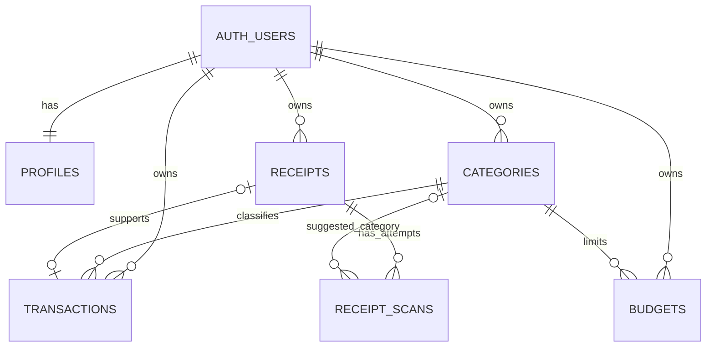

# Database Design

ฐานข้อมูลนี้ออกแบบสำหรับ Supabase/PostgreSQL โดยแยกข้อมูลตั้งต้นของธุรกรรม ข้อมูลไฟล์ และผลการสแกนออกจากกัน ธุรกรรมจะถูกสร้างหลังผู้ใช้ตรวจและยืนยันผลสแกนแล้วเท่านั้น

## ER diagram

`AUTH_USERS` คือ `auth.users` ของ Supabase; ตาราง public อื่นมี `user_id` เป็นเจ้าของข้อมูลโดยตรง ยกเว้น `profiles.id` ซึ่งเป็นทั้ง PK และ FK ไปยัง auth user

## ตารางและความสัมพันธ์

- **profiles** — ค่าตั้งค่าต่อผู้ใช้ เช่น ชื่อ สกุลเงินเริ่มต้น และ timezone
- **categories** — หมวดรายรับ/รายจ่ายของผู้ใช้ ชื่อหมวดไม่ซ้ำกันภายในผู้ใช้และชนิดเดียวกัน หมวดที่มีรายการผูกอยู่ลบไม่ได้ ควร archive แทน
- **transactions** — รายการที่ผู้ใช้ยืนยันแล้ว เก็บจำนวนเงินบวกและใช้ `type` ระบุรายรับ/รายจ่าย โดยหมวดต้องเป็นของผู้ใช้คนเดียวกันและชนิดตรงกัน
- **budgets** — วงเงินรายเดือนต่อหมวดรายจ่าย มี unique key `(user_id, category_id, month)` และบังคับให้ `month` เป็นวันแรกของเดือน
- **receipts** — metadata ของไฟล์ใน private Storage bucket; `storage_path` ไม่ซ้ำและผูกกับเจ้าของ
- **receipt_scans** — หนึ่งแถวต่อความพยายาม OCR/AI เก็บค่าที่ดึงได้, confidence, ข้อผิดพลาด และหมวดที่แนะนำ การ retry สร้างแถวใหม่ ไม่เขียนทับประวัติ

ไฟล์จริงอยู่ใน Supabase Storage ส่วนตาราง `receipts` เก็บเพียง path และ metadata ธุรกรรมอ้าง receipt ได้หนึ่งรายการผ่าน `receipt_id`; การลบ receipt จะล้าง reference ในธุรกรรม โดยเก็บ source=receipt เพื่อระบุที่มาทางประวัติ; แอปควรลบ Storage object ด้วย server-side flow ให้ครบ

## Normalization

- **1NF:** ทุกคอลัมน์เก็บค่าเดี่ยว ไม่มี array ของหมวดหรือรายการธุรกรรม; ผลสแกนแต่ละครั้งเป็นแถวของตนเอง
- **2NF:** ตารางส่วนใหญ่ใช้ UUID PK เดี่ยว; ข้อเท็จจริงที่ขึ้นกับหมวด/งบ/ใบเสร็จแยกไว้ใน entity ที่เกี่ยวข้อง ไม่ฝังเป็นคอลัมน์ซ้ำใน transaction
- **3NF:** ข้อมูลโปรไฟล์อยู่ใน `profiles`, รายละเอียดหมวดใน `categories`, metadata ไฟล์ใน `receipts`, ผล AI ใน `receipt_scans`, และวงเงินใน `budgets`; transaction เก็บเฉพาะข้อมูลที่จำเป็นต่อธุรกรรมที่ยืนยันแล้ว
- หมวดเริ่มต้นถูกสร้างต่อผู้ใช้ ไม่ใช้แถวหมวดกลางที่ `user_id` เป็น null เพื่อให้ composite foreign keys บังคับ ownership ได้โดยตรง

### ค่าที่ตั้งใจเก็บซ้ำ

- `transactions.amount`, `currency_code`, `merchant`, `occurred_at` เป็นค่าธุรกรรมที่ผู้ใช้ยืนยันแล้ว ไม่ได้อ้างค่าจาก receipt scan แบบสด เพราะผู้ใช้อาจแก้ผล AI และประวัติ transaction ต้องไม่เปลี่ยนเมื่อมีการ retry scan
- `receipt_scans.raw_result` เป็น JSONB สำหรับเก็บผลตอบกลับดิบเพื่อวิเคราะห์ปัญหาเท่านั้น; ฟิลด์ relational ที่แยกไว้เป็นข้อมูลที่แอปควรใช้งาน หากไม่ต้องการ audit/debug สามารถตัด `raw_result` ออกได้
- `currency_code` เป็นรหัส ISO 4217 แบบสามตัวอักษรบนโปรไฟล์ ธุรกรรม และผลสแกน เพื่อรักษาสกุลเงิน ณ เวลาที่บันทึกและรองรับการเพิ่มหลายสกุลภายหลัง ไม่เก็บชื่อสกุลเงินซ้ำ

## ข้อกำหนดและความปลอดภัย

Migration อยู่ที่ `supabase/migrations/20261023000100_initial_schema.sql` และเปิด RLS สำหรับทุกตาราง โดย policy จำกัดแถวด้วย `auth.uid()` ส่วน composite foreign keys ป้องกันการผูก transaction, budget, receipt หรือ scan suggestion ข้ามเจ้าของ

สร้าง Storage bucket ชื่อ `receipts` แบบ private แล้วเปิด policies ในส่วนท้าย migration หรือกำหนดผ่าน Supabase configuration ใช้ path `{user_id}/{receipt_id}/{filename}` และตรวจ MIME/ขนาดไฟล์ฝั่ง server ด้วย ห้ามเปิดใช้ service role key ใน client

## การ query ที่คาดว่าจะใช้

- Dashboard เดือน: `transactions` ตาม `user_id` และช่วง `[start, end)` ของเดือนที่แปลงเป็น timezone ใน `profiles`
- ยอดหมวด: aggregate `transactions.amount` แยก `category_id` ภายในช่วงวันที่
- สถานะ budget: join `budgets` กับ aggregate รายจ่ายจริงตาม `category_id` และเดือน; threshold 80%/100% คำนวณจาก limit เทียบยอดรวม ไม่ต้องมีตารางแจ้งเตือนสำหรับ in-app indicator
- รายการธุรกรรมล่าสุด: index `(user_id, occurred_at desc)`

## หมายเหตุสำหรับ implementation

1. ในการสมัคร user trigger จะสร้าง profile และหมวดเริ่มต้น
2. อัปโหลดรูป → insert `receipts` → สร้าง `receipt_scans` สถานะ processing → บันทึกผล success/failed เป็นแถวใหม่
3. หน้าตรวจทานส่งข้อมูลที่ผู้ใช้ยืนยันเพื่อ insert `transactions` และผูก `receipt_id`; จากนั้นอัปเดต receipt เป็น `linked`
4. การลบ receipt ต้องลบ Storage object และแถว database ตามลำดับที่จัดการข้อผิดพลาด/การ retry ได้; หลีกเลี่ยงการทำลาย audit scan โดยไม่จำเป็น
5. การลบ transaction ควรคง receipt ไว้ และปลด reference ให้ receipt ใช้กับ transaction ใหม่ได้

